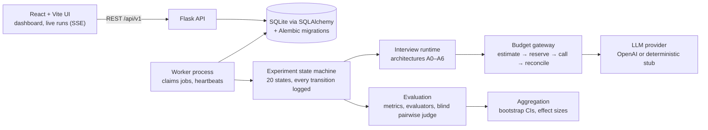

# AI Interview Research Lab


A full-stack platform for testing **which AI-interviewer setup actually works best**: prompts, memory strategies, context, agent workflow and evaluation methods. It runs repeatable experiments against synthetic candidates and backs every conclusion with statistics, cost tracking and human review.

I built it as part of **Evior**, my AI hiring platform, to stop guessing which prompt or memory design made interviews better, and to measure it instead.

> **Try it free:** with `PROVIDER_MODE=stub` the whole system runs locally with a deterministic fake model. No API key, no cost.

<!-- Add a screenshot or GIF here: docs/screenshot-dashboard.png -->

## What it does

- **Runs controlled experiments.** Each one compares interview "architectures" (A0–A6) across 16 synthetic candidate personas and 12 experiment templates.
- **Evaluates the results three ways:** deterministic metrics, independent LLM evaluators, and blind pairwise judging.
- **Reports with statistics, not vibes:** paired deltas, bootstrap confidence intervals, effect sizes and honest result labels (`promising`, `inconclusive`, `rejected`...).
- **Runs a bounded autonomous research loop** that proposes and tests new variants within hard limits on rounds, budget and safety.

## Architecture



**Stack:** Python, Flask, SQLAlchemy, Alembic, Pydantic, OpenAI API, React, Vite, Server-Sent Events, pytest (45 tests), Docker Compose.

## Interesting problems I solved

- **Never overspending on model calls.** Every LLM call goes through a budget gateway that estimates the cost, reserves it, makes the call, then reconciles the real cost against the reservation. An experiment whose estimate exceeds the remaining budget is blocked before launch, and if a run hits the limit mid-way it stops cleanly in a `BUDGET_BLOCKED` state instead of overspending.
- **Making LLM judges trustworthy.** LLM judges favor whichever answer they see first. The pairwise judge runs both orderings and detects position bias. When evaluators disagree, the result goes to human review instead of being averaged away.
- **Keeping the "answer key" away from the interviewer.** Each synthetic candidate has hidden ground truth. Only a guarded repository can read it: it checks the caller's role, blocks interviewer and planner roles completely, locks the holdout set and audits every access. A test suite checks these guarantees.
- **Long-running jobs that survive crashes.** Experiments run in a separate worker process. It claims jobs from the database, sends heartbeats and walks an explicit state machine, so abandoned jobs are detected, and pause, resume and cancel work at any stage. Launches use an `Idempotency-Key`, so a double-click doesn't start two experiments.

> **Note:** in the original setup, baseline architecture A0 imported Evior's private production prompts read-only. Those files aren't part of this public repository, so A0 runs without them here. Everything else works as described.

## Quick start (Windows)

```bat
:: 1. Configure
copy .env.example .env
:: edit .env — set OPENAI_API_KEY and PROVIDER_MODE=openai for real runs,
:: or leave PROVIDER_MODE=stub for a free deterministic demo.

:: 2. Install backend dependencies (Python 3.10+; 3.12 recommended)
cd backend
pip install -r requirements.txt

:: 3. Seed the lab (idempotent)
python seeds.py

:: 4. Run backend API (terminal 1)      → http://127.0.0.1:5058
python app.py

:: 5. Run worker (terminal 2)
python worker.py

:: 6. Run frontend (terminal 3)         → http://localhost:5173
cd ..\frontend
npm install
npm run dev
```

Or use the scripts in `scripts/` (`seed_lab.bat`, `run_backend.bat`,
`run_worker.bat`, `run_frontend.bat`; `.sh` variants for macOS/Linux).

## Migrations

The first run creates the schema automatically. Alembic is configured for
schema evolution:

```bash
cd backend
alembic upgrade head          # apply migrations
alembic revision --autogenerate -m "change"   # future changes
```

## Tests

```bash
cd backend
python -m pytest tests/ -q     # 45 tests: unit, integration, critical safety
```

Tests run entirely in `PROVIDER_MODE=stub` — deterministic, free, no API key.

## Provider modes

- `PROVIDER_MODE=stub` — deterministic local stub. All model calls are labeled
  `provider_mode: stub` in the DB and UI; stub data never masquerades as real
  research findings.
- `PROVIDER_MODE=openai` — real OpenAI calls. Model availability is validated;
  an unavailable model fails with a setup error rather than being silently
  replaced. All calls flow through the budget gateway (estimate → reserve →
  call → reconcile) with versioned pricing.

## Isolation guarantees

- `RESEARCH_LAB_MODE=true` and `ALLOW_PRODUCTION_WRITES=false` are enforced at
  startup of the API, worker, and seed command (`config.assert_isolation`).
- The lab has **no MongoDB/AWS client** anywhere. The production adapter reads
  only the static `prompts_v3.json` / `Intro_outro.json` files, read-only.
- Research data lives in its own SQLite database.
- Hidden persona truth is reachable only through `HiddenTruthRepository`,
  which authorizes by role, blocks interviewer/planner/designer/director roles
  unconditionally, enforces holdout locking, and audits every access.

## The research cycle

1. `python seeds.py` registers `evior-production-baseline-v1` (A0, protected,
   immutable) plus seed architectures A1–A6 and experiment templates E1–E12.
2. In the UI: Experiments → load a template (e.g. E1) → validate & estimate →
   launch. Watch live progress (SSE), transcripts, memory events, costs.
3. Deterministic analysis + independent evaluators + blind pairwise judging
   (both orderings, position-bias detection) run automatically.
4. Aggregation computes paired deltas, bootstrap CIs, effect sizes, win/tie/
   loss, hard-constraint checks, and a result label
   (exploratory / promising / confirmed_within_suite / inconclusive /
   rejected / safety_rejected). Evaluator disagreements are preserved and
   routed to human review — never averaged away.
5. Timeline → "Start autonomous cycle" runs a bounded research loop
   (max rounds/variants/experiments; holdout reserve untouchable; safety stops).
6. Final Report → "Begin final validation" unlocks the holdout suite, then
   launch E12; "Generate final report" produces the evidence-backed
   recommendation with limitations, Pareto frontier, and safeguards.

## Screens

| Route | Screen |
|---|---|
| `/` | Research Dashboard (budget, active experiments, Pareto, review queue, workers) |
| `/architectures` | Architecture Registry |
| `/architectures/:id` | Architecture Detail (components, lineage, prompts, hashes, promote/reject) |
| `/experiments` | Experiment Builder + templates E1–E12 + run list |
| `/experiments/:id` | Live Experiment View + Results Comparison (SSE, transcripts, metrics, CIs, disagreement, critic) |
| `/prompts` | Prompt & Component Editor (versions, diff, restore-as-new, protected markers) |
| `/personas` | Candidate Persona Library (public packets; audited owner-only hidden-truth view) |
| `/timeline` | Research Timeline + bounded autonomous cycle control |
| `/final-report` | Final Recommendation |

## API

Versioned REST under `/api/v1/research-lab` with `{data, meta, errors}`
envelopes: projects/budgets/costs, architectures (versions, lineage, diff,
promote/reject), prompts (versions, diff, restore), hypotheses, personas &
scenario suites, experiments (estimate, launch w/ `Idempotency-Key`, pause,
resume, cancel, progress, SSE `/events`, runs, comparison), runs (transcript,
state, memory, costs, evaluations), research-runs (autonomous cycle), final
validation, final report, timeline, Pareto, review queue, worker status.

## Known limitations (MVP)

- 16 synthetic personas; small repetition counts — results are labeled
  honestly, not claimed statistically significant.
- Semantic duplicate detection uses a labeled lexical fallback unless an
  embedding provider is configured.
- Planner/observer components are represented as configuration-driven behavior
  inside the interviewer runtime rather than separate model calls (cost
  control); E5/E6 measure the policy effect, not a second agent's latency.
- Evaluator and interviewer share the model family — a known bias documented
  in every final report.
- The stub provider is deterministic but simplistic; use `PROVIDER_MODE=openai`
  for research conclusions.
